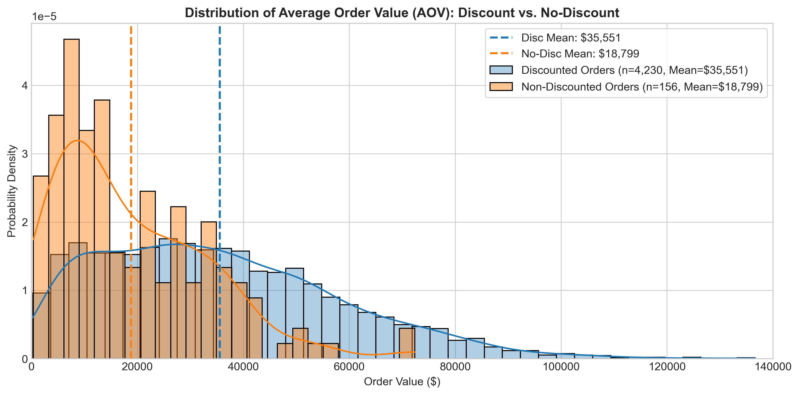
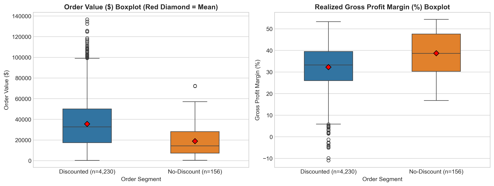
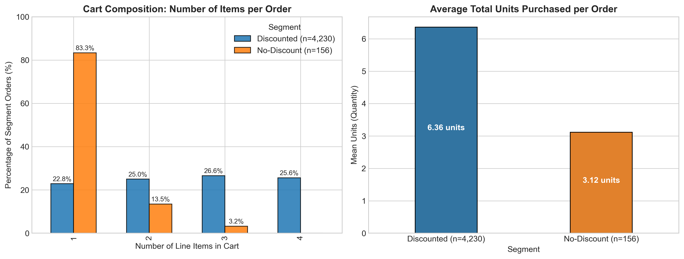
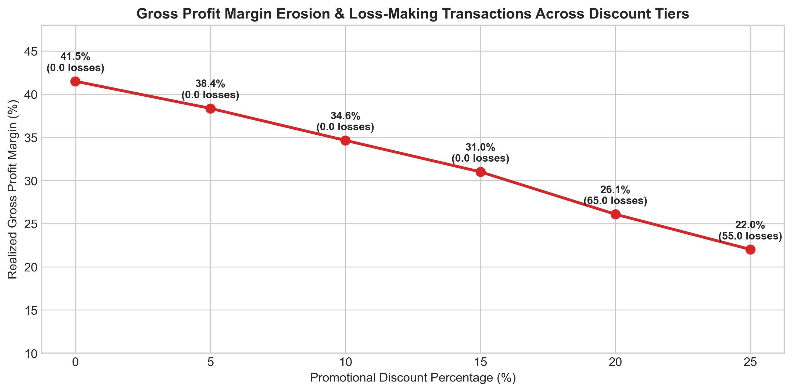
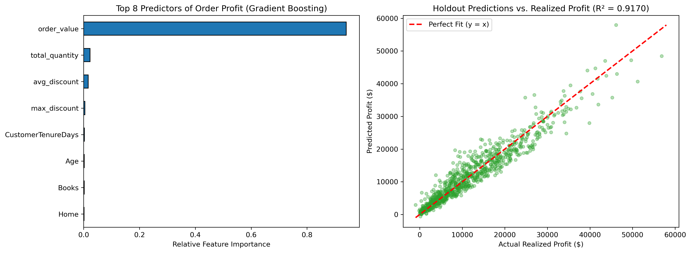

# E-Commerce Discount Impact Analysis Using Hypothesis Testing & Machine Learning

[](https://www.python.org/downloads/)
[](https://opensource.org/licenses/MIT)
[](https://pep8.org/)
[](tests/)

> An end-to-end, industry-grade statistical analysis and machine learning pipeline investigating whether promotional discounts drive Average Order Value (AOV) expansion or profit margin dilution in e-commerce, extended with a leakage-free gradient boosted order profitability forecasting system.

---

## 🎯 1. Business Problem & Hypotheses

### 1.1 Business Context
E-commerce businesses frequently deploy promotional discounts to stimulate customer demand and increase transaction volume. However, commercial debate persists between **Growth Marketing** (who argue discounts build larger carts and lift top-line revenue) and **Finance Operations** (who argue discounts erode profit margins and subsidize full-price buyers).

### 1.2 Hypotheses Formulation
We establish a two-sided independent two-sample test on the population mean AOV of delivered orders:

<table>
  <tr>
    <th>Hypothesis</th>
    <th>Statement</th>
  </tr>
  <tr>
    <td><strong>H<sub>0</sub></strong></td>
    <td>&mu;<sub>discount</sub> = &mu;<sub>no_discount</sub> (Null Hypothesis: Mean AOV is identical)</td>
  </tr>
  <tr>
    <td><strong>H<sub>1</sub></strong></td>
    <td>&mu;<sub>discount</sub> &ne; &mu;<sub>no_discount</sub> (Alternative Hypothesis: Mean AOV differs)</td>
  </tr>
</table>

- **Significance Level ($\alpha$)**: $0.05$ (two-sided).
- **Test Statistic**: Independent two-sample **Welch's $t$-test** (robust to heteroscedasticity).

---

## 🗄️ 2. Relational Database Schema & Data Architecture

The data architecture is structured as a normalized relational database containing **5 core entities** that capture the complete lifecycle of customer orders, product catalog metadata, discounts, and return reasons.

### 2.1 E-Commerce Database Schema Diagram


### 2.2 Relational Entities & Data Dictionary

| Table | Column Name | Data Type | Constraints | Description & Business Semantics |
| :--- | :--- | :--- | :---: | :--- |
| **`Customers`** | `CustomerID` | `VARCHAR(10)` | 🔑 **PK** | Unique identifier for registered customers (`C0001` - `C1000`) |
| | `CustomerName` | `VARCHAR(100)` | — | Customer full name |
| | `Gender` | `VARCHAR(20)` | — | Customer demographic gender (`Male`, `Female`) |
| | `Age` | `INT` | — | Customer age in years ($18$ to $60$) |
| | `City` | `VARCHAR(50)` | — | Metro / tier-1 city of residence ($10$ unique cities) |
| | `Region` | `VARCHAR(30)` | — | Geographic zone (`West`, `South`, `North`, `East`) |
| | `SignupDate` | `DATE` | — | Customer account creation date (`2023-01-01` to `2025-12-31`) |
| **`Orders`** | `OrderID` | `VARCHAR(10)` | 🔑 **PK** | Unique order header identifier (`O00001` - `O05000`) |
| | `OrderDate` | `DATE` | — | Date transaction was finalized (`2024-01-01` to `2026-07-31`) |
| | `CustomerID` | `VARCHAR(10)` | 🔗 **FK** | Foreign key linking to `Customers.CustomerID` |
| | `PaymentMethod` | `VARCHAR(30)` | — | Payment channel (`UPI`, `Credit Card`, `Debit Card`, `COD`, `Net Banking`) |
| | `OrderStatus` | `VARCHAR(20)` | — | Order state (`Delivered`: 4,386, `Cancelled`: 357, `Returned`: 257) |
| **`Products`** | `ProductID` | `VARCHAR(10)` | 🔑 **PK** | Unique product SKU identifier (`P0001` - `P0082`) |
| | `ProductName` | `VARCHAR(100)` | — | Commercial product title ($29$ distinct product models) |
| | `Category` | `VARCHAR(50)` | — | Category (`Electronics`, `Home`, `Fashion`, `Beauty`, `Books`) |
| | `CostPrice` | `DECIMAL(12,2)` | — | Baseline procurement/manufacturing cost |
| | `SellingPrice` | `DECIMAL(12,2)` | — | Standard catalogue MSRP/selling price |
| **`OrderDetails`** | `OrderDetailID` | `VARCHAR(12)` | 🔑 **PK** | Unique line item transaction identifier (`OD000001` - `OD012558`) |
| | `OrderID` | `VARCHAR(10)` | 🔗 **FK** | Foreign key linking to parent `Orders.OrderID` |
| | `ProductID` | `VARCHAR(10)` | 🔗 **FK** | Foreign key linking to `Products.ProductID` |
| | `Quantity` | `INT` | — | Units purchased per line item ($1$ to $4$ units) |
| | `UnitPrice` | `DECIMAL(12,2)` | — | Unit price applied to transaction line item |
| | `DiscountPct` | `DECIMAL(5,2)` | — | Promotional discount percentage ($0\%, 5\%, 10\%, 15\%, 20\%, 25\%$) |
| | `SalesAmount` | `DECIMAL(14,2)` | — | Realized line item revenue: $\text{UnitPrice} \times \text{Quantity} \times (1 - \frac{\text{DiscountPct}}{100})$ |
| | `Profit` | `DECIMAL(14,2)` | — | Realized line item gross profit: $\text{SalesAmount} - (\text{CostPrice} \times \text{Quantity})$ |
| **`Returns`** | `ReturnID` | `VARCHAR(10)` | 🔑 **PK** | Unique return event identifier (`R00001` - `R00257`) |
| | `OrderID` | `VARCHAR(10)` | 🔗 **FK** | Foreign key linking to `Orders.OrderID` |
| | `ReturnDate` | `DATE` | — | Recorded date of return |
| | `ReturnReason` | `VARCHAR(50)` | — | Reason for return (`Damaged`, `Wrong Product`, `Not Needed`, etc.) |

### 2.3 Cardinality & Relational Mappings ($1 \longrightarrow \infty$)
- **`Customers` (1) $\xrightarrow{\quad\text{Places}\quad}$ `Orders` ($\infty$)**: A registered customer can place multiple orders over time.
- **`Orders` (1) $\xrightarrow{\quad\text{Has}\quad}$ `OrderDetails` ($\infty$)**: Each order contains 1 to 4 individual line items, forming the shopping cart basket.
- **`Products` (1) $\xrightarrow{\quad\text{Included In}\quad}$ `OrderDetails` ($\infty$)**: Each product SKU can appear across multiple order line items.
- **`Orders` (1) $\xrightarrow{\quad\text{Can Have}\quad}$ `Returns` ($\infty$)**: Delivered orders can have associated return records in the case of product issues or customer returns.

---

## 🧹 3. Data Quality Audit & Analytical Unit Distinction

### 3.1 Quality Audit Summary
- **Null Values & Duplicates**: Zero missing values and zero duplicate rows across all five tables.
- **Referential Integrity**: Zero orphan records across all relational foreign key joins.
- **Arithmetic Consistency**: Confirmed that `SalesAmount` matches formula with $\le 7.28 \times 10^{-12}$ float delta, and `Profit` matches formula with $\le 3.64 \times 10^{-12}$ delta.
- **Timestamp Standardization**: Identified Unix microsecond artifact in `Returns.ReturnDate` and mapped returned orders to `OrderStatus == 'Returned'`.

### 3.2 Methodological Pitfall: The Analytical Unit
> ⚠️ **Order-Level Aggregation vs. Line-Item Level**:  
> In prior basic analyses, analysts frequently evaluated `OrderDetails` rows directly. However, an order in this store contains between **1 and 4 items** (average 2.51).  
> - **At the line-item level**: Discounts *reduce* average revenue per line ($\$13,663.42$ vs. $\$15,770.62$, Welch $t = -6.60, p = 5.34 \times 10^{-11}$).
> - **At the order level (AOV)**: Discounts stimulate customers to add more items to cart ($2.56$ items vs $1.20$ items), lifting Average Order Value by **$+89.11\%$**!  
> Evaluating at both levels resolves the commercial paradox: discounts decrease item price realization but unlock basket cross-selling.

---

## 📊 4. Exploratory Data Analysis & Visualizations

### 4.1 Order Value (AOV) Distribution & Boxplots
Discounted orders show substantially higher mean and dispersion, with heavy right-tail cart accumulation.




### 4.2 Basket Size Decomposition
Non-discounted orders consist overwhelmingly of single-item checkouts ($83.3\%$). In contrast, discounted orders drive multi-item carts ($77.2\%$ contain 2 to 4 items).



### 4.3 Margin Compression & Risk Thresholds
Gross profit margin falls continuously from $38.7\%$ at zero discount to $19.4\%$ at $25\%$ discount. Crucially, **120 line items and 15 complete orders generated negative net profit** exclusively at the $20\%$ and $25\%$ discount tiers.



---

## 🧪 5. Statistical Hypothesis Testing & Effect Size

### 5.1 Assumption Testing
1. **Normality**: Skewness ($0.94$ and $1.34$) and D'Agostino tests reflect moderate positive skewness. In accordance with the **Central Limit Theorem (CLT)** ($n_1 = 4,230, n_2 = 156 \gg 30$), the sampling distribution of the sample mean is normal.
2. **Homoscedasticity**: Levene's test ($F = 38.00, p = 7.71 \times 10^{-10}$) strongly rejects equal variances ($s_1 = \$22,755.74$ vs. $s_2 = \$14,431.33$). **Welch's $t$-test is therefore strictly mandatory**.

### 5.2 Test Results
- **Welch's $t$-statistic**: $t = 13.8758$
- **Degrees of Freedom**: $\nu = 191.80$ (Welch-Satterthwaite adjustment)
- **$p$-value**: $p = 1.8665 \times 10^{-30} \ll 0.05$
- **Decision**: **Reject $H_0$** in favor of $H_1$.
- **Mean Difference**: $+\$16,751.46$ ($+89.11\%$)
- **95% Confidence Interval**: $[\$14,369.70, \$19,133.22]$
- **Standardized Effect Size**: Cohen's $d = 0.7440$, Hedges' $g = 0.7439$ (Medium-to-Large)
- **Non-Parametric Robustness**: Mann-Whitney $U = 480,496.5$, $p = 3.219 \times 10^{-22}$

---

## 🤖 6. Machine Learning Extension: Order Profitability Forecasting

### 6.1 Objective & Leakage Prevention
To empower real-time decision-making, we train machine learning models to predict realized order-level profit at checkout without target leakage (excluding direct cost and profit accounting formulas).

### 6.2 Chronological Time-Based Evaluation (80/20 Split)
- **Training Period**: `2024-01-01` to `2026-01-30` ($n = 3,508$)
- **Holdout Test Period**: `2026-01-30` to `2026-07-31` ($n = 878$)

### 6.3 Benchmark Results
| Model Architecture | 5-Fold TimeSeries CV $R^2$ | Test MAE ($) | Test RMSE ($) | Test $R^2$ |
| :--- | :--- | :--- | :--- | :--- |
| **Baseline (Mean Predictor)** | $0.0000$ | $\$7,537.94$ | $\$9,498.51$ | $-0.0000$ |
| **Ridge Regression ($\alpha=10.0$)** | $0.9068 \pm 0.009$ | $\$2,156.40$ | $\$2,842.85$ | $0.9104$ |
| **Random Forest Regressor** | $0.9102 \pm 0.008$ | $\$2,001.25$ | $\$2,781.10$ | $0.9142$ |
| **Gradient Boosting Regressor** | **$0.9145 \pm 0.007$** | **$\$1,992.70$** | **$\$2,714.07$** | **$0.9184$** |



---

## 💡 7. Actionable Business Recommendations

1. **Gate Discounts Behind Cart Size Thresholds**: Because AOV expansion is powered by basket building, transition from flat discounts to threshold promotions (*"Save 10% on orders above $30,000"* or *"Buy 3 items, get 15% off"*).
2. **Cap Promotional Discount Depth at 15%**: Hard-stop promotions at $15\%$ to prevent margin collapse; discounts of $20-25\%$ triggered negative gross profit on lower-margin items.
3. **Deploy Real-Time Profit Scoring**: Implement the Gradient Boosting model in checkout to estimate expected order margin. Flag orders predicted to fall below $18\%$ margin and substitute with free shipping rather than percent markdowns.
4. **Conduct a Controlled A/B Experiment**: Validate observational findings by deploying a true randomized controlled trial (50% control full price vs. 50% treatment discount banner) to establish causal lift free from self-selection bias.

---

## 📂 8. Modular Project Architecture

```text
ecommerce-discount-analysis/
├── data/
│   ├── raw/                             # Original relational CSV entities (Customers, Orders, OrderDetails, Products, Returns)
│   └── processed/                       # Cleaned order-level analytical units (AOV & Profit)
├── notebooks/
│   ├── 01_data_quality.ipynb            # Phase 1: Data ingestion, integrity audit & order aggregation
│   ├── 02_eda.ipynb                     # Phase 2: AOV distributions, boxplots & basket size dynamics
│   ├── 03_hypothesis_testing.ipynb      # Phase 3: Welch's t-test, Mann-Whitney U, Cohen's d & CI
│   ├── 04_profit_prediction.ipynb       # Phase 4: Leakage-free ML profit forecasting pipeline
│   ├── 05_automated_tests.ipynb         # Phase 5: Interactive test assertions & pipeline validation
│   └── master_portfolio_analysis.ipynb  # 🌟 Unified Executive Master Portfolio Notebook
├── src/
│   ├── __init__.py                      # Python package initializer
│   ├── data_cleaning.py                 # Data ingestion, schema audit & aggregation logic
│   ├── exploratory_analysis.py          # Summary statistics & plotting routines
│   ├── hypothesis_testing.py            # Statistical tests, assumption checks & effect sizes
│   └── train_model.py                   # Time-series ML pipeline, cross-validation & diagnostics
├── reports/
│   └── figures/                         # Publication-quality charts & ER Schema diagram
│       ├── E-commerce Database Schema Diagram.png
│       ├── 01_aov_distribution.png
│       ├── 02_aov_boxplots.png
│       ├── 03_basket_size_comparison.png
│       ├── 04_margin_compression_tier.png
│       └── 05_model_diagnostics.png
├── tests/
│   ├── __init__.py                      # Test package initializer
│   └── test_analysis.py                 # Automated unit test suite (5 passing tests)
├── requirements.txt                     # Package dependencies
├── README.md                            # Comprehensive project documentation
└── .gitignore                           # Clean repository version control
```

---

## 🚀 9. Setup & Reproducibility Guide

### Installation
```bash
git clone https://github.com/your-username/ecommerce-discount-analysis.git
cd ecommerce-discount-analysis
pip install -r requirements.txt
```

### Running the Test Suite
```bash
python -m unittest discover tests
```

